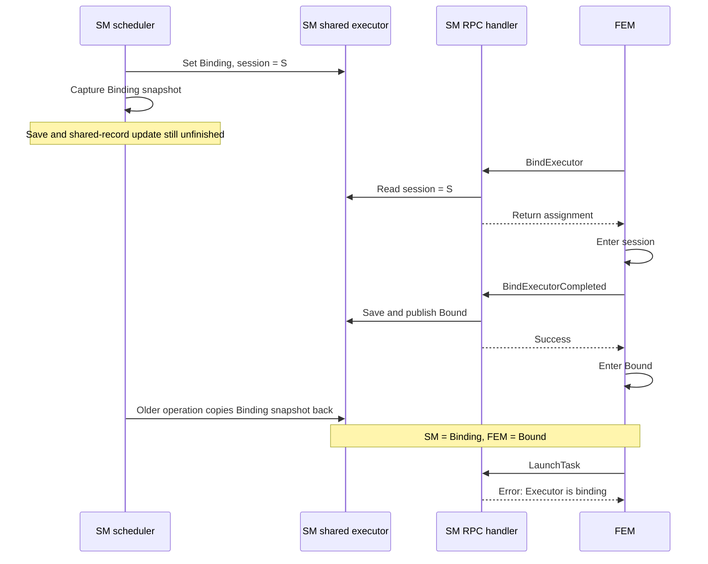
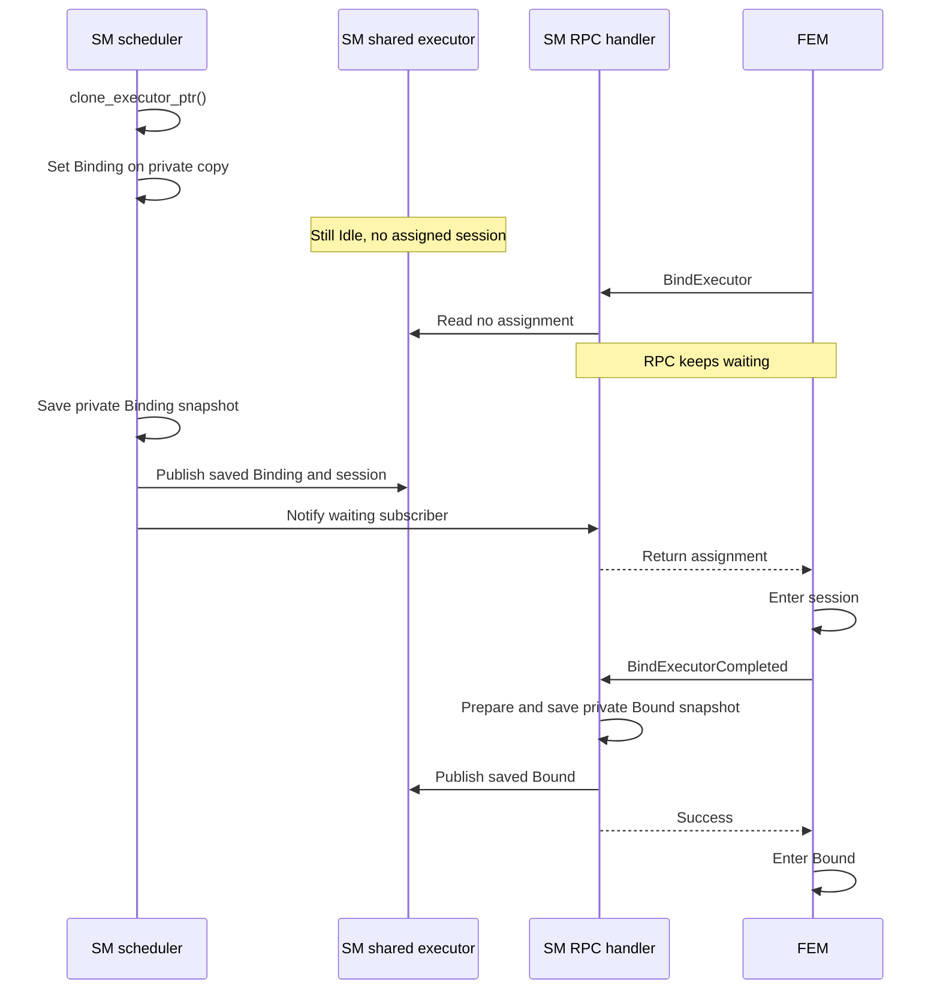

# Executor lifecycle persistence: root cause and flow

Executor lifecycle changes must be saved before they become visible to other
Session Manager operations. The fix prepares each transition on a private
executor copy, saves it, and then publishes it to the shared executor.

## Two independent flows

FEM already waits for its RPCs in order. It retrieves a session assignment,
enters that session, acknowledges binding, and then enters its local Bound state.

The scheduler runs independently inside Session Manager. Two similarly named
operations belong to these separate flows:

| Operation | Caller | Purpose |
| --- | --- | --- |
| `Controller::bind_session()` | SM scheduler | Assign an executor to a session. |
| `BindExecutor` RPC | FEM | Wait for and retrieve the assigned session. |
| `BindExecutorCompleted` RPC | FEM | Report the result of entering the session. |

`BindExecutor` calls `Controller::wait_for_session()`. That method reads the
shared executor and returns its assigned session when `ssn_id` is present. It
does not await the scheduler's `bind_session()` call directly.

## Who waits for the notifier?

FEM calls `BindExecutor` when it enters Idle to ask for the next session.
`ExecutorNotifier` is internal to SM: it wakes the RPC handler while that handler
is waiting in `wait_for_session()`. It does not trigger FEM to start the RPC.

```text
FEM enters Idle
  -> calls BindExecutor
  -> SM subscribes to ExecutorNotifier and checks the shared assignment
      -> assignment exists: return it immediately
      -> no assignment: wait for a wakeup, then check again
```

If the RPC checks after the assignment is published but before the wakeup is
sent, it returns directly. The notification is needed only when the handler
must wait for an assignment to become available.

## Root cause

Previously, scheduler binding changed the shared executor to Binding and set its
session ID before saving the transition. A concurrent `BindExecutor` request
could therefore retrieve the assignment while the scheduler's persistence
operation was unfinished.

Persistence also updated the shared executor after saving the caller's captured
snapshot:

```rust
self.engine.update_executor(executor).await?;

// Previously copied the supplied snapshot into the shared executor.
exe.state = executor.state;
exe.task_id = executor.task_id;
exe.ssn_id = executor.ssn_id.clone();
```

If another operation advanced the shared executor meanwhile, the older snapshot
could overwrite that newer state. In the failing system test, FEM logged that
its executor was Bound while SM rejected its task operation with
`Executor is binding`.

The following is a possible interleaving that produces that mismatch. The CI
logs show the mismatch; they do not trace every step of this interleaving.



Synchronous filesystem writes do not make the whole operation atomic. The
storage engine's file lock and the shared executor mutex protect separate
operations. Other Tokio worker threads can run between snapshot preparation,
the file write, and publication to the shared executor. SQLite can also suspend
the operation while waiting for database access.

A waiter that was already blocked on the executor notification is woken after
binding persistence. The vulnerable path was a request that read the session ID
directly while the assignment was visible but its save was unfinished.

## New binding flow

`clone_executor_ptr()` creates a private executor pointer for preparing the
transition. The canonical shared executor remains Idle without an assigned
session until saving the Binding snapshot succeeds.



The ordering is:

```text
prepare privately -> save successfully -> publish shared state -> notify/return
```

`BindExecutor` still waits asynchronously. Its response now observes a saved
assignment, so the normal FEM handshake cannot advance to Bound while the
earlier Binding snapshot is still being saved or published.

## Publication and notification can interleave

Another operation can run after saved Binding is published but before the
executor subscriber is notified. For example, FEM may read the assignment and
complete binding before that wakeup is sent.

This interval is safe for the binding handshake: the Binding storage write and
shared-record update have already finished. `ExecutorNotifier` carries only the
executor ID. The wakeup makes subscribers read the current shared state; it does
not apply a Binding snapshot. A late wakeup can therefore observe Bound without
reverting it to Binding.

Waiters subscribe before checking shared state. A waiter either reads the
published assignment directly or receives the wakeup after publication.

## Applying the ordering to the lifecycle

| Operation | State visible while saving | Published result |
| --- | --- | --- |
| Register executor | Void | Idle |
| Bind session | Idle | Binding with the assigned session |
| Complete successful binding | Binding | Bound |
| Complete failed binding | Binding | Unbinding |
| Begin unbinding | Previous committed state | Unbinding |
| Complete unbinding | Unbinding | Idle with session/task cleared |
| Release executor | Idle | Releasing |
| Unregister executor | Previous committed state | Delete the record, then mark retained pointers Released and close notification streams |

The scheduler sees Idle only after unbind completion has been saved. This stops
it from starting a new binding while an older Idle snapshot is still being
saved or copied back.

Publishing uses `Executor::set_state()`. Consequently, the volatile interruption
signal is cleared atomically with publication of Idle. It remains set through
Unbinding. Other state publications preserve an interruption that arrived while
the save was pending.

Task launch and completion continue using the shared executor pointer for task
ownership. An interruption also updates the shared pointer immediately because
its signal is volatile coordination rather than a persisted lifecycle state.

For unregistration, existing waiters can retain an executor pointer after it is
removed from the storage map. The controller updates those retained pointers to
Released after deletion succeeds.

The earlier timestamp-based storage repair loop is removed. The normal
lifecycle handshake now establishes the required ordering before exposing the
next state; it does not require a global executor write lock.

## Validation

The regression tests hold an external SQLite write transaction to block an
executor save. This creates an observable interval in which persistence is
unfinished.

- `assignment_is_visible_only_after_binding_is_persisted` verifies that the
  shared executor stays Idle without a session, `wait_for_session()` keeps
  waiting, and the normal Bound handshake succeeds after the write is unblocked.
  The test fails on the original implementation because Binding is exposed early.
- `lifecycle_transitions_are_visible_only_after_persistence` checks registration,
  binding, bind completion, unbinding, unbind completion, release, and deletion.
  It verifies the saved states, signal clearing at committed Idle, and Released
  publication to a retained pointer after deletion.
- Local verification passed all 246 common tests, 242 session-manager tests,
  two common doctests, workspace Clippy with warnings denied, formatting, and
  diff checks.

## References

- [Bug #573](https://github.com/xflops/flame/issues/573)
- [Controller lifecycle operations and regression tests](../../../session_manager/src/controller/mod.rs)
- [Backend BindExecutor RPC](../../../session_manager/src/apiserver/backend.rs)
- [Storage save and shared-record publication](../../../common/src/storage/mod.rs)
- [FEM Idle binding handshake](../../../executor_manager/src/states/idle.rs)
- [Failed Python system-test job](https://github.com/xflops/flame/actions/runs/38340314665/job/115109594253)
- [Fix PR #572](https://github.com/xflops/flame/pull/572)
