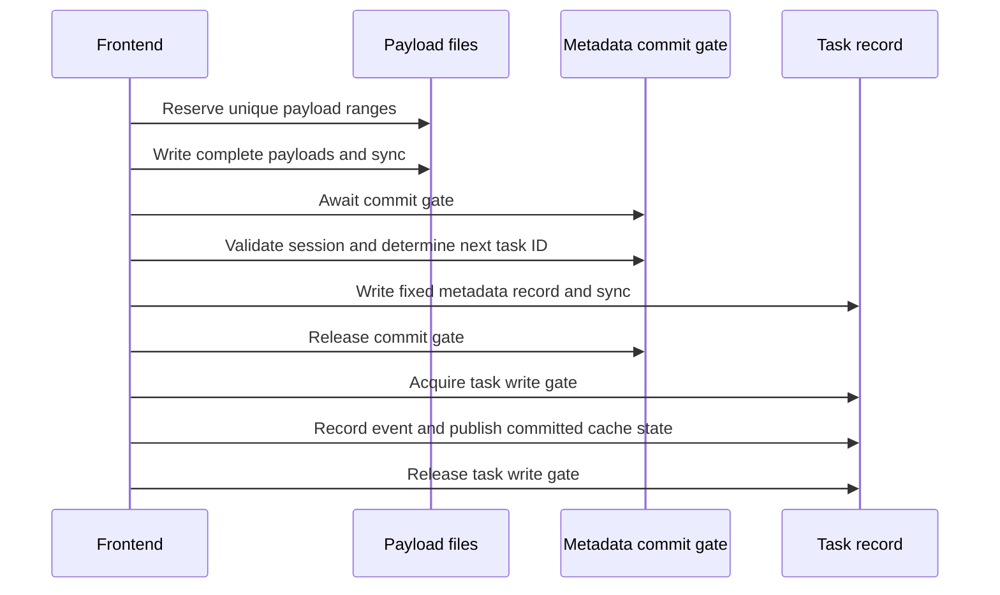

# Improve filesystem concurrency by reducing lock scope

## 1. Motivation

[Issue #577](https://github.com/xflops/flame/issues/577) records storage workloads
that delay heartbeat processing, mark workers NotReady, and stall task execution.
The solution should preserve the throughput motivation of
[RFE209](../../designs/RFE209-filesystem-storage/FS.md).

RFE209 already uses fixed-size task records and append-only payload files. Those
structures support substantially more concurrency than its single session mutex:
a create, an update to an existing task, and a read of another task need not
serialize their entire filesystem operations.

This proposal keeps synchronous `std::fs` I/O and improves the ownership and
scope of in-memory locks. It does not dispatch individual syscalls through
`tokio::fs` (each `open`/`seek`/`read`/`write`/`flush` becomes its own
blocking-pool round trip, and one task update performs dozens of them inside a
lock) or change the heartbeat timeout. Where a whole storage operation executes
(inline or as a single blocking call) is a separate, explicit decision in §3.7.

The goals are concurrent frontend/backend/scheduler progress, heartbeat
responsiveness under the reported workloads, and throughput parity with main.
This is a proposed design, not a claim that the uncommitted prototype already
meets those goals.

## 2. Function specification

### Assumptions inherited from RFE209

| Assumption | Consequence for concurrency |
| --- | --- |
| One Session Manager process owns the storage directory | In-memory coordination is sufficient. External writers are unsupported. |
| Task metadata occupies a fixed record at a known offset | Different tasks can write disjoint ranges without a session/file-wide mutation lock. |
| Task IDs are allocated from the committed metadata file length | Creating metadata records needs a serialized commit step. Atomic ID reservation alone is unsafe with the existing dense-record model. |
| Inputs, outputs, affinity data, and event messages are immutable after publication | Reads can use offsets without taking append or task mutation locks. |
| Payload offsets are stored in the metadata | Physical payload writes can complete out of order, provided referenced payloads are fully written and synced before metadata is committed. |
| Recovery truncates a partial tail, checks `offset + len <= file size`, and validates checksums | Crash consistency is established at recovery, not by a lock that makes a payload and record write look atomic. Only the order matters: payload first, record last. |
| Records carry a `version` for optimistic locking, and retrieval validates the checksum | A reader that observes a torn record sees a checksum mismatch and retries, so metadata reads need no per-task read gate. Stale writers are rejected by version. |
| Sync is optional "based on durability config" (RFE209 Algorithms step 7) | Per-write `sync_data` is a policy, not a requirement of the format. The code currently syncs unconditionally; see the sync policy below. |
| Events are a separate component | Their shared lock must be considered independently; reducing Engine locking alone does not remove event contention. |

Keep URI schemes, public gRPC/SDK interfaces, record formats, checksums, and the
existing required flush/sync ordering. Current metadata includes affinity fields
and uses one-based IDs: `(task_id - 1) * record_size`. RFE209's older approximate
record size and zero-based examples are not a format specification to copy.

Internal coordination awaits Tokio locks (`tokio::sync::Mutex` and `RwLock`);
registry maps use short `std::sync` locks that are never held across I/O or an
await. File operations use `std::fs` and synchronous I/O. Positional I/O
uses `std::os::unix::fs::FileExt` (`read_at`/`write_at`); non-Unix targets are
unsupported by this change.

Sync policy: today every record and payload write is followed by `sync_data`
(`filesystem.rs`, both on main and in the prototype), and each create performs
up to three syncs. Because the commit gate is held across the record's sync,
create throughput is bounded by one sync latency per session, and syncs on the
same file serialize in the kernel regardless of how many task stripes exist.
RFE209 defines sync as configurable. This proposal keeps the existing
always-sync behavior as the default and the only required mode for the lock
changes, but measures sync time separately (§4) and treats a configurable
sync policy as the first follow-up if sync dominates. No option is added until
that measurement justifies it.

The scope is lock granularity, positional I/O, payload allocation, registry
lifetime, and event-store concurrency. Cross-process access, WAL/group commit,
a durability setting weaker than today's default, compaction, and a new
task-cancellation API are outside scope.

## 3. Implementation detail

### 3.1 Replace the session-wide mutation lock

| Operation | Required coordination | Work outside the mutation lock |
| --- | --- | --- |
| Create task | Shared session lifecycle gate, then the metadata commit gate for ID selection and the record write/sync. The new task's write gate is taken only after the commit gate is released. | Payload reservation, writing, and syncing happen before the metadata commit gate. The commit gate is never held while waiting for a task gate. |
| Update task state | Shared lifecycle gate and that task's write gate | Other tasks and payload readers do not take this gate. |
| Complete task | Shared lifecycle gate and that task's write gate for final validation and publication | Stage output in a newly reserved range before taking the task write gate. |
| Read task metadata | Shared lifecycle gate only | Positional read plus checksum validation; retry on a mismatch. Then load immutable payloads. |
| Read payload | Shared lifecycle gate | Positional reads need no task or append lock. |
| Record event | Shared lifecycle gate and per-session event commit gate | Message reservation/write/flush outside the event commit gate. |
| Read events | Shared lifecycle gate and a short cache snapshot lock | Release cache locks before message I/O. |
| Close/delete session | Exclusive lifecycle gate | It excludes active operations and uses the existing lifecycle checks. |
| Registry lookup | Short registry read lock to clone the entry | All entity waits and file I/O happen after releasing it. |

The current implementation keeps one lock per task ID for the life of the session
entry, without eviction, which is unbounded in task history, and readers take
the task's read lock. The planned follow-up, in place of the stripes below:

- Remove a task's lock from memory once the task is done (terminal state), since
  no further writer exists. Memory is then bounded by active tasks, not history.
- Read task metadata directly with no task lock, relying on the checksum
  validation and bounded retry already described in this section, and drop
  `with_task_read`.

Task gates can be a fixed array of Tokio read/write locks indexed by task ID.
Start by evaluating 64 stripes to keep lock memory bounded independently of task
history. Collisions serialize some unrelated tasks; adjust the count only from
measurement. Only writers take a stripe gate; a metadata mutation is exclusive
among writers of the same stripe. The normal RPC read path should continue using
the existing committed cache when available.

There is no shared seek cursor or `tasks.bin` mutex across all task records.
Metadata updates use complete positional reads/writes on a handle owned by the
session entry (§3.6). A fixed-size write is not assumed to be atomic, so readers
do not rely on a lock to avoid a torn record: they validate the checksum
(RFE209 retrieval step 3) and retry a bounded number of times on a mismatch.
Persistent mismatch is corruption and follows the corruption policy. The record
version still lets a writer detect that it read a stale record.

The task write gate retains same-task mutation ordering through event
recording and cache publication. This is a correctness boundary for one task,
not a reason to block operations on the entire session. Cache version checks
still reject older snapshots. The metadata commit gate for creation is released
once the new record has passed the required sync; it is not held through event
I/O or response delivery.

A stripe gate held across event I/O makes collided tasks wait for each other's
events, and the per-session event commit gate (§3.5) is a second serialization
point on every update. §3.5 states how this is measured and what is decided if
it dominates.

### 3.2 Allocate payload ranges without an I/O lock

Maintain an independent checked atomic end offset for each payload file. Seed
it from that file's length when the session is created or recovered. For a
payload of length `n`, reserve `[offset, offset + n)` atomically. Reject overflow.
Then write the complete payload at that offset and perform the existing sync.
Neither writing nor syncing holds an allocation mutex.

Use positional writes on files opened without append mode. On Linux, positional
writes on an `O_APPEND` file do not honor the requested offset, as documented by
[Rust's FileExt](https://doc.rust-lang.org/std/os/unix/fs/trait.FileExt.html).
Handle short reads/writes and interruptions correctly.

Allocation remains append-only logically: existing published bytes are never
overwritten. Physical writes may extend the file out of order. A cancelled or
failed operation can leave an unused range or sparse hole, which no metadata may
reference. Do not roll an allocator backward while other reservations exist.
On restart, initialize it from the actual file length; reservations from the
terminated process cannot still write into that file. Session-generation checks
prevent old queued requests from targeting a reused session ID.

These unreferenced bytes are compatible with offset-based payload lookup, but
space amplification must be measured and failure tests must verify that no
published record refers to an incomplete payload. Reclaiming these bytes is a
separate compaction feature.

### 3.3 Keep task creation's dense metadata commit narrow

A fully lock-free task-ID allocator is not selected. Reserving IDs with an atomic
counter would let a later task extend `tasks.bin` beyond unfinished earlier
records. File length would then count empty/partial slots as tasks, violating
RFE209's allocation/recovery assumptions. Solving that requires an explicit
committed-record index or another format/recovery protocol.

Creation instead follows this flow:



The shared lifecycle gate spans this flow. The commit gate covers ID allocation
and the metadata write/sync, not the larger input/affinity writes. Updates to an
existing task never acquire it and can proceed while new tasks are staged or
waiting to commit.

The commit gate is a leaf: nothing is awaited while holding it except the record
write/sync. In particular it never waits for a task stripe gate. Otherwise an
update holding a colliding stripe through event I/O would block every create in
the session (a 1-in-64 chance per create). The new task's stripe gate is taken
after the commit gate is released, only to order its event and cache publication.
This is safe because the new ID is not in the cache, a scheduler snapshot or any
response until that publication, so no other operation can reference the task
between commit and publication.

Retain existing failure/recovery behavior for metadata writes. A failed commit
must not blindly reuse an ID based on a stale cached counter or pretend that a
partial record is valid. File length is sufficient only when the existing
prefix is validated and no previous commit has an uncertain outcome. It must
not count an incomplete or corrupt tail as a committed task.

### ID assignment is part of the task commit

Flame's SQLite implementation performs per-session `MAX(id) + 1` inside the
`INSERT`, in a transaction, and commits before returning the task. It does not
use `AUTOINCREMENT` for these task IDs. SQLite serializes writes; allocation is
protected by the same write transaction as row insertion. See
[Flame's allocator](../../../common/src/storage/engine/sqlite.rs) and
[SQLite isolation](https://www.sqlite.org/isolation.html).

Use the same logical boundary for filesystem creation:

```text
stage and sync payload
    -> acquire metadata commit gate
    -> select private candidate ID from validated committed prefix
    -> write and sync task metadata
    -> advance committed allocation state
    -> release commit gate
    -> finish event/cache publication and return ID
```

Do not persist a separate sequence ahead of the task. Any in-memory committed
count advances only after successful metadata sync, while the commit gate is
held. Rebuild it from validated records after restart, not the highest reserved
number. Do not put a candidate ID into a response, cache, scheduler snapshot, or
notification before its record is committed. Metadata persistence is the
allocation commit point.

| Interruption | Required recovery and allocation behavior |
| --- | --- |
| Payload staged, no metadata record | Leave payload unreferenced. No task ID was committed or exposed. |
| New tail record incomplete or invalid | Reject/discard the uncommitted tail using recovery policy, then restore the dense committed prefix. Do not count file length alone. |
| Complete record survives process restart | Validate ID, checksum, and payload ranges; recover the task. Its ID remains allocated even if the caller received no response. |
| Metadata sync succeeded, publication/response unfinished | Recover the saved task and rebuild its cache. Do not reuse its ID. |
| Write/sync reports an uncertain commit outcome | Stop new creation in that session until the tail and durability are reconciled. Do not advance or reuse an ID speculatively. |

Recovery runs before exposing a session: validate complete records and their
payload references, handle an incomplete tail, and rebuild allocation state.
An invalid record inside a committed prefix is corruption, not a reason to
silently reuse its ID or discard later committed tasks. Follow the corruption
policy and fail closed when recovery cannot establish integrity.

This prevents a published ID without a saved task. It does not provide
exactly-once creation after a lost response: a task can commit before its caller
disconnects, and an independent retry may create another task without an
idempotency mechanism. Do not delete a valid task to avoid that ambiguity.

### 3.4 Stage completion output independently

Reserve, write, and sync output while holding the shared lifecycle gate but
before taking the task's write gate. Then acquire that gate and repeat the
existing task/executor ownership and state validation. Read the latest metadata,
update its output reference, state, version, timestamp, and checksum, and
write/sync the record. Finally record the event and publish through the existing
cache/version rules before releasing the task gate.

If final validation rejects a stale result, its staged output is unreferenced;
it must not alter task metadata. This design does not relax existing ownership
checks or solve the separate lost-node cleanup race.

Metadata readers copy a committed record with a validated positional read and
load its referenced bytes afterwards, holding no task lock. Those bytes remain
immutable even if a newer record points at a different output, so the reader
gets a consistent older snapshot without holding a task lock through payload I/O.

### 3.5 Apply the same reasoning to events

Replace the global event-storage I/O lock with per-session storage entries.
The map lock only retrieves/clones an entry or changes its membership. Message
ranges use the immutable-payload allocation scheme above. A per-session event
commit gate protects event-ID allocation, the event record, owner index, and
cache publication in their existing order.

`find_events` clones the relevant event metadata under a short cache lock, then
loads message ranges without holding the global cache lock. The shared session
lifecycle gate protects file lifetime. Preserve normal event error behavior;
do not introduce an eager full-message cache or new startup I/O in this change.

First implementation scope: `EventManager` is a synchronous trait on main, so
per-session entries use short `std::sync` locks and the event payload is still
written through `DataStorage`'s cursor under the session entry. Positional
payload allocation for events, and a lifecycle gate shared with the engine, need
an asynchronous event interface and are left for a follow-up once the engine
changes are measured.

The event component remains separate from Engine, as in RFE209, but coordinates
with the session lifecycle. Event removal cannot race a queued writer that
recreates deleted files. Old entry holders must observe the removed generation;
a newly created session with the same ID gets a new entry.

Every task state update records an event inside its task gate, and events for a
session pass through one event commit gate that covers the event record, owner
index and their sync. That gate recreates a per-session serialization point:
update throughput across different tasks is bounded by one event write and sync,
however many task stripes exist. This proposal keeps the existing ordering
(persist task, record event, publish cache; RFE573) and measures event commit
gate wait and hold time separately from the task gates. If that gate is shown to
bound throughput, the decision to take to review is whether event recording must
precede cache publication, or may follow it outside the task gate with
reconciliation on failure. Do not change that ordering as part of the initial
lock-scope work.

### 3.6 Lock order, lifecycle, and failure handling

The common lock order is:

```text
registry lookup and release
    -> shared session lifecycle gate
    -> creation commit gate (create only; leaf, released before any task gate)
    -> task gate when required
    -> event commit gate when required
    -> short cache publication locks
```

Creation holds the commit gate and a task gate sequentially, never nested.
Creation and updates both acquire the lifecycle gate before any task gate.
Mixed ordering can deadlock with a writer-fair lifecycle lock. Close/delete takes
only the exclusive lifecycle gate plus event-removal coordination; it must not
then acquire creation/task gates. No cache guard is held while awaiting another
gate or doing file I/O.

Bound active operations before they acquire a lifecycle reader, using existing
request concurrency controls or a small per-session admission bound. Waiting
admission/lock acquisition yields; it does not occupy runtime threads. A pending
lifecycle writer prevents new readers so existing admitted operations can drain.
This is concurrency control, not a background execution pool. The exact bound
must be evaluated with the documented 30,000-request workload.

Applications, nodes and executors each have a registry of shared entries
(`Arc<RwLock<Entry>>`) holding their persisted metadata. An entry is the entity's
gate and its cache: a writer saves the metadata first and then publishes it to
the entry, so readers never observe unsaved state. Registry maps use short
`std::sync` locks that are never held across an await or file I/O. Entity guards
may enclose that entity's own file I/O.

- Sessions, applications, nodes and executors are loaded once when the engine
  starts (unreadable records are logged and skipped). A create inserts the entry,
  already write-locked until it is saved, and the entry is held until the entity
  is deleted. There is no lazy load, so the cache is authoritative: a missing
  entry means the entity does not exist.
- Every holder re-validates after acquiring a guard that its entry is still the
  registered one. A waiter on a deleted entry gets `NotFound`, and callers that
  can tolerate deletion (`get_node`, `get_executor`, `delete_*`) retry or return
  `None`/`Ok`.
- Session creation takes the application's read gate when the application exists,
  so it coordinates with application deletion and update (which take the write
  gate) without serializing sessions. An application need not be registered, and
  the application name must not be empty. Application deletion also scans
  sessions under its write gate and fails closed on unreadable metadata.
- Executors belong to a node. Lock order is node (read) -> executor. Operations
  on an executor take its node's read gate, so node deletion (write gate) waits
  for them and then evicts that node's cached executors. An executor moving to
  another node takes the new node's gate and removes its old directory under the
  executor gate. Readers and writers that observe a changed node retry.
- Node and executor mutations never take session, task, payload-allocation or
  event gates. Routine heartbeat updates are in-memory (`ReadyState::update_node`)
  and take no entity gate; only registration and state transitions persist.

Event storage is created with the session (`EventManager::setup_events`, also
called for open sessions during recovery) and its file handles stay open until
the session's events are removed. There is no lazy open and no in-place close.
Recording into a session without event storage returns `NotFound`, so a late
writer cannot recreate files for a removed session.

Deletion waits for active lifecycle readers, removes files/handles, marks the
old generation removed, and removes the registry entry only if it still matches
that generation. Readers of closed history remain supported.

Handle ownership: positional I/O needs open files, so each session entry opens
its `tasks.bin` and payload files once, shares them as `&File` (positional calls
need no exclusive access or cursor) and closes them on delete. Do not retain
handles per task, and do not add a process-wide handle cache with its own lock;
bound open descriptors by the number of active sessions and measure that bound.
Reopening a file for every operation is not acceptable on the update path.

Cancellation before metadata commit can leave unused staged payload, but cannot
publish a task/result that has not been saved. Preserve persistence-before-cache
publication. Events are diagnostic: a failure to create, record, load or remove
them is logged at error level and never fails or rolls back the storage operation.
This does not add transaction-level cancellation atomicity or power-loss
atomicity across files.

### 3.7 Heartbeat behavior and the limit of this proposal

Routine heartbeat resource updates in `ReadyState::update_node` update memory;
they do not persist a node record on every heartbeat. Registration/drain/state
transitions do perform persistence. Keep those behaviors distinct.

The proven contention scenario had runtime workers waiting on storage mutexes
while heartbeat messages arrived. Awaitable, narrowly scoped gates release
those workers to poll the heartbeat stream. Registry/cache/node guards must be
short and must not enclose filesystem calls. Heartbeat processing never needs a
session commit, task, payload-allocation, or event commit gate.

Synchronous file I/O still occupies the thread executing it. Reduced locking
addresses contention-driven starvation; it does not guarantee responsiveness
when every runtime worker is actually stuck in slow filesystem calls. Validation
must distinguish lock wait from I/O duration and demonstrate that this proposal
resolves #577 under the supported workloads. If actual I/O still causes missed
heartbeats, that is an unresolved design requirement, not a passing result or a
reason to silently raise the timeout.

Execution placement is a required decision, not an implementation detail.
Scenario 2 of #577 was observed on main, which already performed synchronous I/O
with two runtime workers, so "throughput parity with main" and "resolves #577"
are different goals. Narrower gates remove lock-wait starvation only. The options
for where a whole storage operation (for example read record, validate, write,
sync) runs are:

| Option | Effect | Cost |
| --- | --- | --- |
| Inline on the runtime worker | Lowest per-operation overhead; matches main. | A worker is occupied for the full operation, including sync. Two workers can all be busy. |
| One `spawn_blocking` per whole operation | Workers stay free to poll heartbeats. | One thread-pool hop per operation (not per syscall), added latency of tens of microseconds. |
| `block_in_place` on the multi-thread runtime | No hop; other tasks migrate off the worker. | Requires the multi-thread runtime and still reduces runnable workers while blocked. |

The second option is not a per-syscall `tokio::fs` dispatch and not a storage
worker pool; the whole operation is one closure over `std::fs` and positional
I/O. Select the option from the measured I/O and sync durations against the
heartbeat budget, and record the choice in this document before the performance
gate.

## 4. Use cases and validation

### Frontend and backend progress within one session

Submit `flmping -p -t 30000` and record task creation/completion timelines,
scheduler bindings, and heartbeat ACK latency. Backend completions must progress
while frontend requests remain in flight. Repeat with staggered sessions and
10 workers. Verify every output, task ID, state version, checksum, and reopened
record. Normal operations on different task records must not serialize behind
payload I/O or a file-wide cursor lock.

### Deterministic contention cases

Hold the creation commit gate longer than the heartbeat timeout: updates to an
existing task and heartbeat processing should remain responsive. Hold one task
write gate: unrelated task stripes and other sessions should progress. Hold one
task stripe gate, then create a task whose ID collides with that stripe: the
create must still commit its record and release the commit gate, and other
creates must not wait for the held stripe. Hold one session's event commit gate:
other sessions and heartbeat updates should progress. Inject a torn metadata
record (partial write observed by a reader) and verify the reader retries and
returns a committed snapshot, and that a persistent mismatch is reported as
corruption. Verify same-task read/write consistency and lifecycle-writer
ordering. These tests prove contention behavior; they do not measure actual disk
latency.

### Allocation and failure cases

Force payload reservations/writes to finish out of order, cancel between staging
and commit, inject short writes and sync failures, and reopen storage. Verify
unique offsets, unchanged earlier payloads, no metadata reference to unwritten
bytes, and correct next offsets. Test dense task-ID allocation under concurrent
creates, failed metadata commits, close/delete, same-ID reuse, and partial
records. Kill/restart SM after payload sync, during metadata append, after
metadata sync, and before returning the ID. Verify every exposed ID reconstructs
a task, incomplete tails never advance allocation, and valid committed records
are never reused. Keep event/task cache state consistent with saved metadata
after event failure.

### Performance and merge gate

Compile before timing, let host load stabilize, and alternate main/fix runs with
identical durability, VM/cluster resources, client/task-service binaries,
logging, and executor limits. Report all successful and failed samples, first
completion delay, operation lock-wait/I/O/sync durations, and heartbeat latency.
Record host CPU/swap and guest I/O pressure.

The earlier main rate drifted from roughly 725 tasks/s to a later successful run
near 352 tasks/s, followed by a heartbeat stall. Those absolute rates cannot
isolate implementation overhead. Establish normal variation with interleaved
main/main controls, then require throughput parity within that variation and no
false NotReady transitions. README's environment-unspecified rate is a reference,
not a comparable regression baseline.

Step 0, before changing locking: instrument the existing code (on main and on
the prototype) with per-operation lock-wait, I/O and sync durations, the number
of syncs per create and per update, and event commit gate wait/hold time. The
loss relative to main must be attributed (lock, sync, event gate, or thread-pool
hops) from that data before the design is judged. A micro-benchmark on a laptop
filesystem is not a substitute: on macOS `sync_data` dominated both main and the
prototype equally (about 50 ms per task) and hid every other difference. Run the
attribution on the target Linux storage.

Then implement positional I/O and shorter lock scopes, retaining disk formats and
sync requirements. Validate task/offset/lifecycle correctness, then heartbeat
and throughput acceptance. Evaluate batching, caching, a configurable sync
policy, or execution isolation separately only if this design fails its measured
goals; the sync policy is the first candidate when sync time dominates. The
existing uncommitted finer-lock worktree is an unvalidated prototype.

## 5. References

- [Issue #577: observed concurrency failures](https://github.com/xflops/flame/issues/577)
- [Issue #209: filesystem-storage motivation](https://github.com/xflops/flame/issues/209)
- [RFE209 design](../../designs/RFE209-filesystem-storage/FS.md)
- [PR #377: filesystem implementation](https://github.com/xflops/flame/pull/377)
- [Filesystem Engine](../../../common/src/storage/engine/filesystem.rs)
- [Event storage](../../../common/src/events/fs.rs)
- [Storage cache/publication](../../../common/src/storage/mod.rs)
- [Heartbeat stream](../../../session_manager/src/apiserver/backend.rs)
- [Ready-state resource updates](../../../session_manager/src/controller/nodes/ready.rs)
- [RFE573 lifecycle persistence ordering](../bug573/report.md)
- [Rust positional I/O and append-mode behavior](https://doc.rust-lang.org/std/os/unix/fs/trait.FileExt.html)
