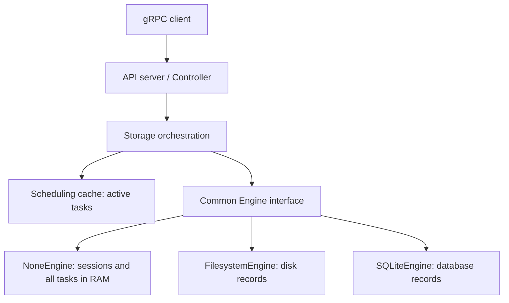

# Design Document: None Storage for Non-Recoverable Tasks

This document describes the in-memory engine and scheduling-cache limits,
including task retention under [RFE659](../RFE659-finished-task-cache/FS.md).
“Non-recoverable” means that a new engine process cannot recover these records
from disk; completed results remain available while the engine is alive.

## 1. Motivation

Filesystem and SQLite provide durable task storage but perform disk I/O. Some
workloads prefer keeping their complete task history and results in memory to
avoid that overhead. The `none` engine serves those workloads through the same
Engine interface used by persistent backends.

The goals are to:

- Retain sessions, tasks, input/output, and results in memory for fast reads and
  updates, without disk persistence.
- Preserve task get, watch, list, retry, and session lifecycle behavior through
  the common engine interface.
- Limit the scheduling session cache independently of engine retention.
- Preserve existing public APIs, SDKs, and backend selection configuration.

Typical uses include serving workloads whose results can be recomputed after
restart, benchmarks measuring engine performance without disk I/O, and local
development. In-memory history deliberately consumes RAM proportional to the
records and payloads retained.

## 2. Function Specification

### Configuration

Use the existing storage selector and cache limit:

```yaml
cluster:
  name: "flame-dev"
  storage: "none"
  limits:
    max_sessions: 10000
```

`cluster.limits.max_sessions` controls the scheduling session cache. Closed
sessions can be removed from that cache when enforcing the limit. This is not
a limit on retained NoneEngine sessions, tasks, payloads, or total memory; open
sessions alone can also exceed the cache target when no closed entry can be
evicted. Without a configured limit, this cache eviction is disabled.

No public API, protobuf, SDK method, or new configuration option is required.
Filesystem and SQLite remain available through their existing storage URLs.

### Record ownership and lifetime

NoneEngine owns all task records for its sessions, including terminal states,
input/output, affinity data, versions, and timestamps. The scheduling cache
owns only active task pointers. A task completing and leaving that cache does
not delete its engine record.

Task get and watch can read a finished record from NoneEngine after scheduling
cache eviction. Task listing combines all active cached snapshots with all
finished engine records, just as it does for persistent backends. Session
metadata remains available through engine `get_session` and `find_sessions`.
Existing cache-only controller lookups remain cache-only; they do not define
the lifetime of engine records.

Closing a session keeps its task records and results. Evicting a closed session
from the scheduling cache also keeps its engine metadata and task history.
Explicit session deletion removes the owned session records, tasks, payloads,
and ID allocation state. A new NoneEngine instance starts empty; nothing is
recovered from a previous session-manager process.

### Scope

In scope are in-memory session/task storage, common Engine lifecycle operations,
thread-safe access, and scheduling session-cache limits. Persistent snapshots,
distributed storage, backend history limits, and a new cleanup policy are out
of scope. Existing explicit deletion and session-retention behavior continue
to apply.

## 3. Implementation Detail

### Architecture



Storage performs active-task admission, event handling, and scheduling-cache
publication. Backend storage and record lifetime belong to the selected engine.
The in-memory backend is not an empty engine that delegates all ownership to
the controller cache.

### NoneEngine records and mutation authority

NoneEngine retains complete Tasks alongside its existing session lifecycle
metadata and task ID allocation state. Task creation validates the session,
allocates its ID, stores the initial record, and updates session counters.
State updates, result writes, and retries resolve the stored task and derive
new state/version from that authoritative record. The common state/result
methods receive an active Task snapshot, but its cached state or version is
not authoritative over the stored record.

The engine uses its existing synchronization to coordinate its records and
lifecycle transitions. No new task-operation gate, per-version history, or
backend capability flag is introduced. Retaining the current task record is
sufficient for reads and version checks; finished task payloads remain owned
by the engine.

The relevant Engine contracts are:

| Operation | In-memory behavior |
| --- | --- |
| `create_session` | Store session lifecycle metadata and initialize owned task state |
| `get_session` / `find_sessions` | Return retained engine session metadata, including closed sessions |
| `create_task` | Allocate and retain a complete initial Task and update counts |
| `get_task` | Return the stored active or finished Task, including payloads |
| `find_tasks(&TaskFilter)` | Return every stored task matching its session and optional state filter, without a limit |
| `update_task_state` / `update_task_result` | Validate lifecycle and update the authoritative stored task and counters |
| `retry_task` | Apply the existing retry operation to the authoritative stored task |
| `close_session(id)` | Validate task states, cancel actual Pending records, and return accurate final counters |
| `delete_session` | Remove the session and all owned task records, payloads, and ID state |

Task get/watch responses add available event history through the existing event
manager. Closing a session removes events under the current retention rule;
retaining its task records does not extend event retention. New watches on a
closed session keep the existing subscription restrictions.

### Scheduling cache and reads

`Session.tasks` and its state indexes retain active Tasks only, uniformly for
all backends. Terminal publication removes scheduling ownership and updates
logical counters. There is no Session retention-policy flag or `none` branch
in Storage mutation publication.

A client read first uses the active cache and falls back to `Engine::get_task`
on a miss. It returns a detached Task snapshot and does not repopulate the
scheduling cache. Lists copy active cached Tasks, read terminal tasks using
`TaskFilter::terminal`, and exclude IDs already selected in the active snapshot.
Active snapshots are returned first, followed by history, with no limit or
pagination. The two reads are not a transactional snapshot.

Controller lifecycle mutations still require an active cache entry. A missing
entry skips a late task update rather than loading history and making it active
again. The normal FEM lifecycle awaits launch, invocation, and completion in
sequence. Session-locked membership and version checks prevent a delayed
publication from recreating an evicted task. Engine writes, event recording,
and cache publication remain separate operations.

### Session close and cache eviction

```mermaid
sequenceDiagram
    participant C as Controller
    participant S as Storage
    participant E as NoneEngine
    C->>S: close_session(id)
    S->>E: close_session(id)
    E->>E: Reject Running; cancel stored Pending tasks
    E-->>S: Closed Session with final counters
    S->>S: Apply returned metadata/counters; clear active task maps
    S->>S: Remove events; enforce scheduling-cache limit
    Note over E: Session/task history remains in engine memory
    S-->>C: Closed Session
```

The engine owns close-time validation and count calculation. Close cancels the
actual stored Pending tasks, preserves terminal results, and rejects Running
work. Repeated close returns the final closed metadata and counters without
applying cancellation twice. Storage passes only the ID and applies the engine
response uniformly across backends, with no cached counter parameter or
backend-specific close branch.

Scheduling-cache eviction removes a closed session pointer, not engine data.
Only explicit session deletion or loss of the engine process ends the retained
NoneEngine history's lifetime. Session retention that deletes sessions uses
that ordinary delete operation.

### Recovery and resource behavior

A new NoneEngine has no persisted records to reload. Reusing an existing engine
instance retains its records independently of scheduling-cache membership.
Persistent-engine recovery still loads complete task history and payloads to
rebuild counters, then retains only active scheduling tasks.

Scheduling task-cache memory is proportional to active work. NoneEngine memory
is proportional to all retained sessions, task records, and payloads. The
`max_sessions` setting limits scheduling-cache residency and does not bound
backend history. Full task listings also allocate their complete result sets.
This is an intentional tradeoff for memory-backed operations; it is not a
bounded-memory history store or durable backend.

No disk durability or post-restart recovery is provided by NoneEngine. Existing
authorization, event handling, and transport behavior remain unchanged.

### Verification

- Finish tasks in every terminal state and verify they leave scheduling indexes
  while get, watch, and list still return their stored results.
- Exercise stored task state/version authority, retries, and counter transitions
  using older caller snapshots.
- Close a session with Pending tasks and verify stored records become Cancelled;
  reject close with Running tasks and preserve final counts on repeated close.
- Evict a closed session from the scheduling cache and verify the engine still
  returns its session metadata and task history.
- Explicitly delete a session and verify its task records and payloads disappear.
- Create a new engine instance and verify previous records are absent.
- Verify the same Storage APIs work for all backends without retention flags,
  backend capability checks, or special mutation-publication branches.

## 4. Use Cases

**High-throughput ephemeral workload:** select `storage: "none"`, submit tasks,
and consume results from get/watch/list while the process remains alive.
Completed records remain in engine memory for later reads. Explicitly delete
sessions when their histories are no longer needed; restart begins empty.

**Scheduling cache limit:** configure `max_sessions` to evict eligible closed
sessions from the scheduling cache. The in-memory backend retains their metadata
and task histories, so this limit does not cap total RAM usage.

**Durable workload:** keep filesystem or SQLite storage when results must survive
a session-manager restart. Active scheduling-cache eviction still works through
the same common Engine API.

## 5. References

- [Issue #394](https://github.com/xflops/flame/issues/394).
- [RFE659 finished task cache eviction](../RFE659-finished-task-cache/FS.md).
- [RFE209 filesystem storage](../RFE209-filesystem-storage/FS.md).
- [Engine interface](../../../common/src/storage/engine/mod.rs).
- [NoneEngine](../../../common/src/storage/engine/none.rs).
- [Storage orchestration](../../../common/src/storage/mod.rs).
- [Controller](../../../session_manager/src/controller/mod.rs).
- [Configuration](../../../common/src/ctx.rs).

The original RFE394 proposal referenced
`session_manager/src/storage/engine/mod.rs` and
`session_manager/src/storage/mod.rs`; those implementation paths are historical.
The current storage implementation resides under `common/src/storage`.
