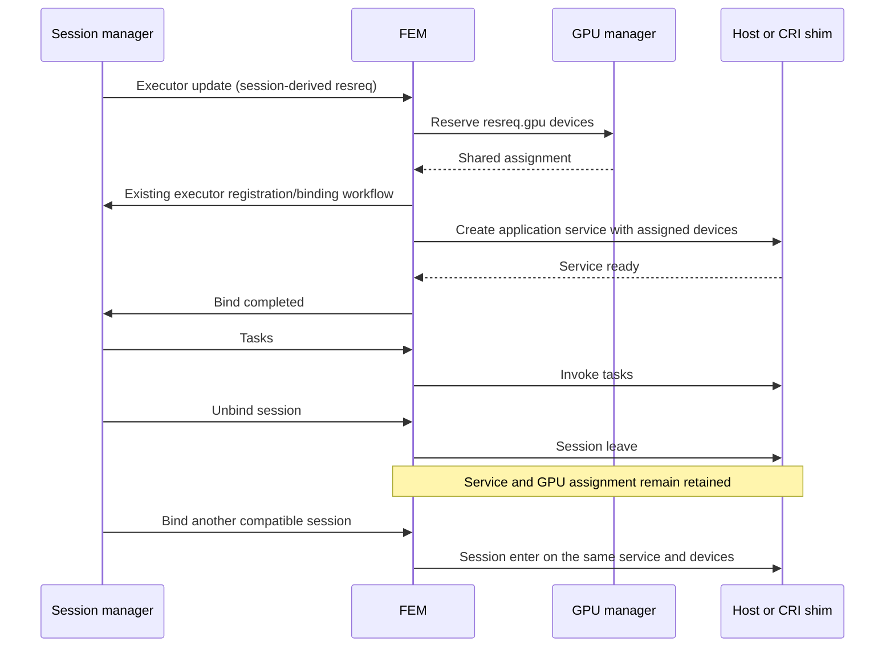

# FEM GPU selection

Tracking: [#565](https://github.com/xflops/flame/issues/565)

Status: Draft. Implementation is on `feat/gpu-selection-runtime-image`;
physical GPU integration validation remains pending.

Related designs: [GPU accounting and DRF](../RFE433-gpu-drf/FS.md) and
[CRI executor shim](../RFE525-cri-shim/FS.md).

## 1. Problem and scope

The scheduler already accounts for `resreq.gpu` when choosing a node. FEM
previously launched Host services without assigning physical devices, so two
executors requesting one GPU could both initialize a model on GPU 0. The vLLM
examples worked around this with application-level `CUDA_VISIBLE_DEVICES=0`.
The CRI shim accepted application images but rejected GPU requests.

Issue [#565](https://github.com/xflops/flame/issues/565) connects existing GPU
resource accounting to physical device selection. FEM owns local GPU assignments;
the scheduler continues allocating executors by resource counts. Host services receive CUDA visibility. CRI services receive explicit CDI
requests for the assigned devices, allowing execution in an application image.

The service and its GPU assignment are application/executor scoped. A session
binding does not create a separate GPU allocation or service lifetime.

This change does not introduce a Kubernetes provider, modify scheduling policy,
add GPU sharing or memory quotas, or switch the Helm DaemonSet to CRI. FEM still
uses the whole dedicated host. Runtime configuration remains an operator concern.
Runtime-image integration in this issue is limited to injecting the assigned
devices and host drivers through
CRI/CDI; the existing image field and image publishing workflow remain in use.

## 2. Ownership and invariants

| Component | Responsibility |
| --- | --- |
| Session manager / scheduler | Select a compatible node and allocate/release executors using session resource requests. |
| FEM GPU inventory | Discover the device identifiers that this FEM may use and advertise their count. |
| FEM device managers | Reserve disjoint devices for each executor and retain ownership until service cleanup finishes. |
| Host shim | Start the service with the assigned CUDA visibility; stop and reap its process group on release. |
| CRI shim | Start the application image with explicit CDI devices; delete the workload on release. |
| Host operator / container runtime | Provide drivers, device access, CDI specifications, runtime policy, and dedicated worker hosts. |

With the GPU device manager enabled (the default), the following invariants apply:

1. An executor reserves exactly `resreq.gpu` devices before its worker starts.
   Replayed executor IDs reuse their saved assignment in every lifecycle state.
2. Two locally managed live executors cannot own the same device identifier.
3. Unbinding a session leaves the service and its assignment intact. Idle
   retention consumes GPU capacity because the retained model may still use it.
4. The assignment remains unchanged on rebinding and WatchNode reconnects.
5. GPU capacity becomes reusable only after service cleanup and an explicit
   manager release. Dropping assignment copies never frees devices.
6. Each manager allocates atomically. If a later manager fails, earlier claims
   remain owned by the executor for retry or cleanup.
7. GPU-free services receive empty CUDA visibility; application and installer
   environment settings cannot override the assignment.
8. A restarted FEM restores persisted assignments before advertising capacity;
   session manager requests cleanup for executors missing from the local report.

Host CUDA visibility is cooperative selection. It does not restrict access to
other device files or prevent an application from changing its own environment.
CRI device injection provides the container's configured device boundary.

## 3. Inventory and assignment model

FEM loads device managers listed in `cluster.executors.devices` and calls their
`DeviceManager::discover()` before registering its node. `GpuManager` discovers
FEM's local GPU inventory through its private discovery module.
The shared `common` crate contains no GPU discovery or NVML dependency:

- With no FEM-level `CUDA_VISIBLE_DEVICES`, discover physical GPU UUIDs through
  NVML. A host without NVML is a valid CPU worker with an empty GPU inventory.
- An explicit empty value or `-1` disables GPUs.
- An explicit mask preserves its device order. Host mode supports indices,
  complete GPU UUIDs, modern MIG UUIDs, or legacy MIG path identifiers.
- Reject malformed identifiers, duplicate identifiers, abbreviated UUIDs, and
  mixed identifier families that could describe overlapping devices. Normalize
  numeric and UUID spelling before checking duplicates.
- NVML failures after initialization fail discovery rather than advertising
  capacity that FEM cannot assign reliably.

For CRI, use complete GPU or modern MIG UUIDs that exist in the host's CDI
specification. Numeric CUDA indices can differ from CDI indices, and legacy MIG
paths differ from CDI names. Device managers emit identifiers without selecting
a shim; the runtime resolves CDI names. Unrestricted NVML discovery produces UUIDs.

FEM discovers its inventory at startup. StreamHandler rediscovers device
inventory on every node refresh before reading complete capacity for initial
registration, reconnection, and heartbeats. Discovery is callable through shared
manager pointers and synchronized with allocation/release inside the GPU manager.
A failed refresh preserves the previous report: registration returns an error and
the heartbeat skips sending invalid capacity. It refreshes host CPU/memory from a clean baseline
and merges manager capacity by per-resource maximum to avoid double-counting
host resources. Reported capacity is total inventory, not unreserved devices.
Rediscovery can add devices or remove unassigned devices. Removing an assigned
GPU or changing its MIG identity fails refresh; stop its workloads and release
its assignments before reconfiguring the hardware.

`devices::DeviceManager` defines synchronous `discover()`, `capacity()`,
`allocate(&Executor)`, and `release(&Executor)`. FEM's `DeviceManagers`
registry constructs implementations without shim configuration, then discovers
their inventory and stores them as `Arc<dyn DeviceManager>`. Discovery refreshes
inventory and restores saved ownership; allocation state remains validated. Invalid
refreshes (including disappearance of an allocated device) preserve the previous
inventory and return an error.
It passes the executor to each manager without device-specific prechecks. Managers
use its ID for allocation ownership and its resource request for device selection. Each manager validates its own request; an empty registry allocates
no devices and advertises zero device capacity. A partial attempt keeps earlier
manager-owned claims for retry or explicit cleanup. Device managers release
ownership explicitly when FEM removes a released executor from its local map;
dropping assignment copies has no effect. For a server-pushed Released, FEM
marks the local executor Released, releases devices, and removes the map entry.
Service destruction happens in normal Releasing before unregister. The worker exits when it observes Released. No outer mutex wraps state
transitions. Service operations use the existing shim mutex, while the GPU
manager mutex protects its allocation map. Allocation errors return to `run`;
Service cleanup or unregister errors retain ownership for the executor loop to retry;
FEM device-release errors retain the map entry and return to `run`. There is no availability callback or
pending-executor queue.
GPU discovery and reservation logic remain under `devices/gpu/`.

```yaml
cluster:
  executors:
    shim: host
    devices: [gpu]
```

Omitting `devices` defaults to `[gpu]`; `devices: []` disables device discovery
and advertises zero GPU capacity. Duplicate names are invalid. GPU is the only
implemented manager today; TPU and other unknown names produce a startup error.
Adding TPU also requires a resource request/capacity field and shim integration;
listing `tpu` alone does not provide TPU support.

`GpuManager` stores an ordered inventory and an executor-ID-to-assignment
allocation map.
It chooses the first available identifiers for a request and reserves the entire
set atomically under the allocation-map mutex. Repeated allocation for an executor
returns its existing assignment unchanged. A new executor ID allocates devices
from its resource request; the manager does not inspect executor state. The map stores assignment descriptions rather than executors, avoiding
manager-pointer ownership cycles. This is local device selection, not an additional
scheduler policy.

`Executor.assignments` stores cloneable `DeviceAssignment` descriptions keyed
by device type (currently `"gpu"`). Each contains only device IDs, environment
variables, and CDI settings. The GPU manager owns the executor-ID-to-assignment
map; the assignment duplicates no identity or rollback metadata. Cloning or
dropping an assignment does not change ownership. Release receives executor
metadata and removes its internal map entry after service cleanup. Executor IDs
are unique and never reused for a different executor lifetime. A manager's
allocation failure leaves its own map unchanged; earlier managers' successful
claims remain available for retry or executor cleanup.
No physical device IDs are added to node or executor RPC messages or storage.

`Executor.app_mgr` retains a shared `Arc<ApplicationManager>` pointer. RPC
conversion leaves it unset; FEM attaches it and prepares assignments synchronously
before invoking `executor::start`. Allocation errors return directly to FEM's
`run`, which inserts the executor into its local map after allocation succeeds
and before starting the executor loop.
`executor::start` only launches the worker loop; it does not allocate devices.
FEM obtains assignments through the same lookup-or-create operation for every
new local executor. Unknown Released updates are ignored. State snapshots clone
the application-manager pointer without recreating it. Idle uses it for
installation and service creation. Executor has no device-manager pointer;
FEM owns the device registry and all physical allocation/release operations.
`Executor::release` clears local assignment, shim, session, and task metadata and
sets Released. It does not free the registry's reservations or delete saved
assignment files. Releasing destroys the service and completes unregister before
calling this local release. FEM then releases the registry's assignment by
executor ID before removing the executor from its map.
The worker and state factory do not accept manager arguments.
`states::from(client, executor_ptr)` creates its snapshot internally; Idle owns
only its snapshot. Factory lock failures return an error.

## 4. Startup and normal workflow



Repeated updates for an existing executor do not create another assignment.
When devices are unavailable, allocation returns an error without inserting a
local executor. A subsequent creation update can allocate after previous owners
release their devices. An unknown `Released` update is an idempotent no-op.

### Host shim

Merge the application and installer environment first, then use
`HostShim::apply_assignments` to apply `envs` from every device assignment. These
settings override application and installer values. Conflicting values from two
assignments fail before launch. The Host helper currently supports environment
settings only; device validation belongs in the owning manager.

`GpuManager` populates `CUDA_VISIBLE_DEVICES` with assigned physical IDs, or an
empty value for a CPU-only executor. A one-GPU service sees its selected device
as CUDA device 0. With `devices: []`, Host receives no assignment settings and
preserves the application's environment; disabling managers opts out of Host
GPU visibility management as well as discovery.

Host service sockets use `/var/flame/shim/<executor_id>.sock` by default;
`FLAME_SOCKET_DIR` can override the directory. CRI keeps its socket in the existing
private, per-executor mounted work directory.

GPU devices and driver libraries must be accessible inside FEM. The existing
Python installer preserves dependency, application, and inherited driver library
paths. The FEM process itself can run in the existing privileged Kubernetes
DaemonSet; this design does not change that deployment profile.

### CRI shim and runtime image

The existing application `image` field selects the runtime image. The application
and FEM both use the existing CRI shim contract. A GPU request no longer fails
solely because the application uses CRI.

For assigned UUIDs, construct CDI names such as:

```text
nvidia.com/gpu=GPU-aaaaaaaa-aaaa-aaaa-aaaa-aaaaaaaaaaaa
```

`ContainerSpec.cdi` becomes CRI `ContainerConfig.cdi_devices`. The
runtime resolves those names and injects devices and driver libraries according
to the host CDI specification. Container security remains unprivileged.

`DeviceAssignment.envs` and `cdi` are implemented. The GPU manager always
populates both fields using the assigned device identifiers. It retains no shim
configuration. Host applies generic envs and ignores CDI; CRI applies both
fields without GPU-specific lookup or request validation. Conflicting assigned environment values fail atomically; CDI names
are deduplicated while preserving each manager's device order. Shared assignment
`resources` remains proposed.

CUDA visibility uses the assigned identifiers, including GPU UUIDs, in either
shim. Assignment envs include `NVIDIA_VISIBLE_DEVICES=void` so legacy NVIDIA
runtime injection does not add devices alongside explicit CDI requests.
With GPU management enabled, GPU-free containers receive no CDI devices and
empty CUDA visibility. With `devices: []`, CRI leaves device environment settings
untouched and emits no CDI requests.

The existing multiarchitecture `xflops/flame-instance-runtime` image supplies
Flame, Python, and the service runtime. The runtime image defaults
`NVIDIA_VISIBLE_DEVICES` to `void`; host driver injection belongs to CDI, not a
baked driver layer. Applications may select another compatible image through
`flmctl deploy --image`. The image and mounted application installation must provide compatible runtime
dependencies and support the host driver's CUDA compatibility requirements.

Flame continues using containerd's configured default runtime. A CPU-only gVisor
configuration does not imply GPU support; the operator must select/configure a
GPU-capable runtime. The same existing CRI work-directory and installed-package
mounts remain required.

## 5. Release, errors, and restart

### Normal release

Releasing destroys the retained service, completes the existing executor
unregister flow, and marks the local executor Released. This clears local shim
and assignment metadata while physical ownership remains in the device manager.
FEM releases that ownership, including the persisted assignment file, before
removing the executor from its local map. State and shim copies do not control
reuse. A device-release failure keeps the map entry and claim and returns an
error to FEM's `run`.

For Host execution, send SIGTERM to the process group and wait for the leader.
After a bounded wait, escalate to SIGKILL. Also kill remaining workers after a
leader exits and wait for the process group to disappear. Preserve the process
group ID independently of the leader's PID handle so cleanup can retry after the
leader has been reaped. A cleanup error retains the instance and assignment.
Workers that escape the process group are outside this cleanup model.

For CRI execution, use the existing executor ownership labels and workload
stop/delete operations. Delete and executor unregister must complete before FEM releases the
manager-owned assignment. Cleanup errors retain ownership and are retried.

### Binding and terminal updates

Normal Releasing destroys the retained service, unregisters the executor, and
marks its local snapshot Released. Session manager deletes the stored executor
and sends a Released notification through the ordinary update stream. Unregister
uses only the executor ID; an already absent record is an idempotent success
without another notification.

FEM handles a Released update directly: it marks the local executor Released,
releases the device-manager assignment by executor ID, and removes the local map
entry. It does not destroy the service; normal Releasing already completed that
before unregister. Physical device release must succeed before the entry is
removed. Errors retain the entry and device ownership and return to `run`. Unknown Released
updates are ignored. The worker exits when its shared executor is Released, and
late successful transitions cannot overwrite that terminal state.

`executor::start` accepts only the backend client and executor pointer. There is
no interrupt signal, unregister metadata/resend, extra RPC, heartbeat cleanup,
timer, polling loop, or worker-handle registry. Idle owns only its local snapshot;
the State interface contains execute only.

Successful services remain executor scoped across session bindings. Startup
cleanup failure logs an error and returns Releasing so the retained shim can
be published through a successful transition. Other state errors are logged
without copying their failed snapshot; CRI can find retained runtime containers
from executor metadata during creation or Releasing cleanup. Host process
reattachment is not supported.

### FEM restart

The GPU manager persists each assignment in
`<workdir>/gpu/<executor-id>.json`. The filename identifies the executor;
the file contains only `devices`, `envs`, and `cdi`. Allocation writes an atomic
replacement and syncs it before updating the in-memory map. Release removes
that executor's file and syncs the directory before freeing its devices.
Repeated release tolerates an already removed file. Discovery scans the GPU
directory and validates saved assignments before FEM reports capacity.
Executor IDs must be valid single filename components; incomplete atomic-write
temporary files do not count as assignments. `allocate(&Executor)`
returns the existing assignment for that executor ID unchanged, or creates and
persists a new assignment when the ID is absent;
lookup, restore, and executor enumeration are not device-manager APIs.
Device allocation has no state check. Existing IDs reuse saved ownership;
absent IDs allocate from their resource request. FEM ignores unknown Released
updates instead of creating executors for them. Cleanup calls release with
executor metadata, removing saved ownership directly by executor ID.

On registration, FEM reports its local executors. Session manager supplies
their authoritative application, resource request, and state. Executors in its
database that FEM does not report enter Releasing for cleanup. Consequently,
a FEM process restart does not preserve those services through registration.
CRI shim service creation first looks up the executor's existing workload and
reconnects its socket. It creates a new service only when no workload exists,
before modifying any retained socket or installing the application. Bound and
Unbinding report a missing local shim as an error rather than recreating it;
a failed normal bind may still complete unbinding after service cleanup.
FEM has no separate recovery API. CRI handles and executor
specifications are not serialized in the assignment file. Failed reconnection
or invalid ownership prevents adopting the service and follows executor cleanup.
Release destroys the service and unregisters the executor before FEM deletes its
saved assignment. A crash after unregister succeeds but before that deletion
can leave a saved reservation without a session-manager executor record. Startup
keeps that reservation, but registration cannot reconstruct the missing record;
operator cleanup is required for this case.

The working directory must survive the intended restart so device ownership
remains reserved until cleanup. Helm's work `emptyDir` survives a container
restart but not replacement of the Pod. Preserve the work volume when replacing
the Pod if runtime services and assignments remain on the host.
Run one FEM per dedicated host. Host process reattachment and recovery of
in-flight task execution are outside this assignment-persistence change.

## 6. Configuration and compatibility

No new scheduler settings or GPU fields are added to the public API. Clients
continue requesting resources such as `resreq="gpu=1"`. The existing executor
limits, application shim, image, and retention settings remain in effect.

Existing application-level CUDA masks are overridden. Remove the GPU-0 workaround
from vLLM deployment commands. Limit a FEM's inventory at FEM startup if needed;
for CRI, use full UUIDs. GPU-free services now explicitly hide CUDA devices.

Host execution needs no runtime image. CRI image execution requires host drivers,
NVIDIA CDI specifications, CDI-enabled containerd, and a compatible default
runtime. See the [GPU runtime tutorial](../../tutorials/gpu-runtime.md) for setup
and the serving deployment command. The Helm chart remains Host-only.

## 7. Acceptance criteria and validation

Issue #565 is complete when all of the following are verified:

- Concurrent GPU executors receive disjoint devices matching their requests.
- Exhaustion leaves the failing manager unchanged; successful claims from earlier
  managers remain executor-owned for retry or cleanup.
- Retained services keep their assignments across sessions and reconnects.
- CPU executors do not inherit application GPU visibility settings.
- Release and failed-binding cleanup finish before device reuse.
- CRI restart and cleanup failures cannot expose GPUs still owned by surviving
  containers.
- Malformed and aliased masks are rejected without assuming that CUDA and CDI
  numeric indices are equivalent.
- Automated allocation and lifecycle regression tests pass.
- Real GPU tests demonstrate concurrent execution, retained vLLM reuse, and CDI
  driver/device injection with a compatible runtime image.
- Examples and operator documentation no longer require the GPU-0 workaround.


Automated coverage includes:

| Scenario | Expected behavior |
| --- | --- |
| Two executors request one GPU each | Assign disjoint identifiers. |
| Request exceeds available devices | Return an error without a partial reservation or local executor. |
| Manager explicitly releases an allocation | Permit reuse on a subsequent allocation. |
| Assignment copies are dropped | Keep devices reserved until explicit release. |
| Repeated release of an executor ID | Leave assignments owned by other executors untouched. |
| Released update | Mark Released, release devices, and remove the local entry after normal Releasing destroyed the service. |
| Session unbind or repeated executor update | Preserve the assignment and retained service. |
| Normal release | Destroy the service, unregister, mark Released, then let FEM release the saved assignment and remove the executor. |
| Service destruction fails in Releasing | Retain the assignment and retry without unregistering. |
| Unregister request targets a missing executor | Return idempotent success without another notification. |
| FEM device release fails | Retain the map entry and saved claim; return the error. |
| Transition finishes after local Released | Preserve the terminal state. |
| Bind failure reporting RPC fails | Log the error; CRI can find retained workloads from executor metadata during cleanup. |
| Service startup fails | Destroy the recorded instance, then clear it; retain allocation. |
| CPU-only service with an application CUDA mask | Override visibility to empty. |
| Host application and installer override visibility | Child receives the FEM assignment. |
| Host worker survives its leader or ignores SIGTERM | Kill and wait for the entire process group. |
| CRI GPU request | Forward assigned CDI devices without privileged container access. |
| CRI service creation sees managed and foreign workloads | Reconnect the matching executor service and ignore foreign workloads. |
| Persisted assignments are malformed or reference unavailable devices | Fail startup before reporting capacity. |
| Malformed, duplicate, aliased, or incompatible masks | Reject configuration. |

Run the verification below for the current branch; test counts change as
lifecycle coverage evolves.

Run the relevant Rust suites, formatting, and the CI Clippy command. Physical GPU
validation still needs two or more GPUs: start concurrent services, inspect the
visible UUIDs, verify retained assignments across unbind/rebind, and verify reuse
after release. Repeat through CRI with real CDI injection and a runtime image;
verify driver loading, service reconnection, and cleanup after restart. CPU unit tests and subprocess tests do
not establish CUDA compatibility or real driver injection.

## 8. Operational limits

- Capacity represents GPU devices, not GPU memory or utilization. This design
  provides whole-device reservations; it does not introduce sharing policies.
- A retained executor keeps its GPUs even while Idle. Existing application
  retention and executor limits control that capacity tradeoff.
- GPU topology, NUMA placement, peer-to-peer connectivity, and heterogeneous GPU
  requirements do not influence local selection in this version.
- Conservative Host cleanup can hold capacity while orphaned zombie processes
  await reaping by the supervisor. Safety takes precedence over early reuse.
- This implementation does not automatically partition MIG devices or rediscover
  GPUs after driver changes. Stop workloads and restart FEM after such changes.

## References

- [NVIDIA CDI setup and injection](https://docs.nvidia.com/datacenter/cloud-native/container-toolkit/latest/cdi-support.html)
- [CUDA and NVML device-index distinction](https://nvidia.github.io/cuda-python/cuda-core/latest/generated/cuda.core.system.Device.html)
- [Containerd CRI configuration](https://github.com/containerd/containerd/blob/main/docs/cri/config.md)
