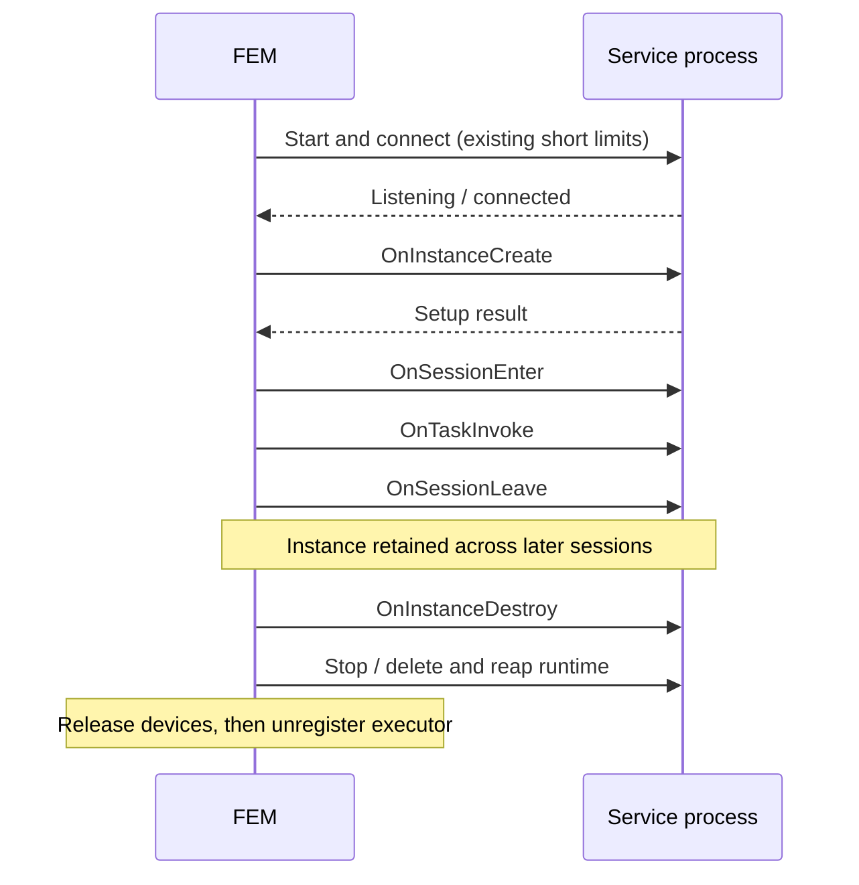

# Design: Instance Setup and Teardown Hooks

## 1. Motivation

### Background

A Flame service instance belongs to an application and executor. The first
session binding creates it; later bindings reuse it; executor release destroys
it. The protocol currently exposes only session enter, task invoke, and session
leave, so applications have no explicit place for instance initialization or
cleanup.

The vLLM serving example constructs its model at module import. Loading larger
models can take minutes, while FEM expects the service to become reachable in
30 seconds. This produces a connection failure even when the process is healthy
and loading weights. Moving initialization into the first task avoids the
connection deadline but reports setup errors as task failures.

On the inspected baseline (`280fb37e`), `GrpcShim::connect` waits for the socket's
`.ready` marker and then connects, with a 30-second limit for each stage. CRI
also bounds readiness/connection with an outer 30-second deadline and watches
for early container exit. The marker indicates a listening server; it must not
wait for application setup. Package installation and image preparation precede
these stages and retain their existing behavior.

### Target

- Separate runtime connection from application setup, with phase-specific
  failure messages.
- Initialize application resources once per service process, before its first
  session enter when using a new FEM.
- Retain those resources across session bindings and release them during
  executor teardown, before stopping the process and releasing device claims.
- Keep existing services compatible with a new FEM; services using instance
  hooks require an updated FEM.
- Keep the current scheduler states, bind retry policy, and runtime ownership.

## 2. Function Specification

### Configuration

No new application configuration, CLI flags, or environment overrides are added.
Instance-hook timeout policy and configuration are deferred to a later
enhancement. Keep the existing short readiness/connection limits unchanged;
they apply only until the service is connected. The shim and SDKs await
instance-create/destroy replies without a separate hook deadline.

An unresponsive setup or teardown hook can therefore keep binding or release
waiting until the RPC fails or the runtime is stopped. A deadline for that wait
is outside this change.

### Shim protocol and bind results

Append these methods to `Instance` in `rpc/protos/shim.proto`:

```proto
rpc OnInstanceCreate(EmptyRequest) returns (Result) {}
rpc OnInstanceDestroy(EmptyRequest) returns (Result) {}
```

Both hooks are instance scoped and receive no session data. Applications use
configuration/environment available to their process for setup. Session common
data and tokens continue to belong to `OnSessionEnter`.

`Result.return_code == 0` means success. A nonzero result includes the service's
setup/cleanup error in `message`. Treat gRPC `UNIMPLEMENTED` as a successful
no-op for these two methods only. Transport errors and other gRPC statuses are
failures. Keep the existing local shim transport and access model.

Bind results use `return_code = 0` for success and `-1` for failure. Put the
phase and original error in `message`, rather than defining phase-specific
numeric error codes.

| Failure phase | Message content |
| --- | --- |
| Runtime start, readiness, or connection | `shim creation failed: <error>` or `shim service creation failed: <error>`, including the failed connection stage. |
| Instance-create hook | `on_instance_create failed: <error>`, including the original application or RPC error. |
| Session enter | `on_session_enter failed: <error>`. |

Setup transport failure messages identify loss of the connected service.
No task is started and no successful bind is reported until setup and session
enter both succeed. FSM already handles any nonzero bind result by recording
the failure and applying its existing session retry limit; no new retry counter
or scheduler policy is needed.

The executor stays in `Binding` while setup runs. Emit phase-specific events
and logs rather than introducing a new persisted executor state.

### Python service and serving APIs

Add default no-op methods to the synchronous `FlameService`:

```python
def on_instance_create(self) -> None: ...
def on_instance_destroy(self) -> None: ...
```

The aio service exposes matching async methods. The existing service adapter
forwards both. Synchronous callbacks execute in the existing dedicated hook
thread pool; async callbacks execute on the server loop. Start the gRPC server
and publish readiness before invoking either application setup or session work.

Add one optional setup callback and one optional teardown callback to
`serving.Instance`:

```python
ins = serving.Instance()
engine = None

@ins.setup
def create_engine():
    global engine
    from my_model_runtime import Engine
    engine = Engine.from_pretrained("model-name")

@ins.teardown
def teardown_engine():
    global engine
    if engine is not None:
        engine.close()
        engine = None

@ins.entrypoint
def generate(request):
    return engine.generate(request)
```

These decorators accept synchronous zero-argument callbacks, return the
registered callable, and reject duplicate registrations. Missing callbacks are
no-ops. Do not run setup at decoration/import time or teardown on session leave.
Setup must complete before admitting an entrypoint invocation.

Async lifecycle hooks remain available through the aio `FlameService` API.
Async serving setup/teardown decorators are out of scope: the current serving
adapter uses a per-call event loop for async entrypoints, which cannot safely
own persistent async resources created during setup.

Apply the same ordering to serving's debug HTTP path using its FastAPI lifespan:
setup before admitting requests, teardown during graceful shutdown. It must not
bypass initialization merely because it bypasses the shim RPC servicer.

### Compatibility and scope

| FEM | Service SDK | Behavior |
| --- | --- | --- |
| New | New | Explicit setup before session enter; teardown before runtime termination. |
| New | Old | Both new RPCs return `UNIMPLEMENTED`; existing lifecycle continues unchanged. |
| Old | New | Instance hooks are not called; services depending on them require an updated FEM. |
| Old | Old | Existing behavior. |

Both SDKs provide default no-op lifecycle methods, so existing service
implementations do not need to add methods. Services that depend on instance
setup/teardown require a FEM that sends the new RPCs. There is no implicit
first-task setup or older-FEM fallback. Regenerate checked-in protocol bindings
with the repository's existing tooling.

In scope: Host and CRI services, Python sync/aio services, serving decorators,
diagnostics, tests, and the vLLM serving example.
Wasm keeps default no-op lifecycle hooks; changing its WIT contract is separate.

The new lifecycle responses contain only `Result`; they do not carry executor
attributes. Keep the existing publisher behavior and session/task attribute
response paths, without adding a lifecycle-specific publication restriction.
No new model-ready attribute or scheduling policy is added.

Generic `flamepy.app` class constructors remain unchanged. `runpy` learns the
class and constructor arguments from session common data, after instance create;
it cannot move them earlier without a separate context/API change. The offline
vLLM App example therefore requires separate work, while the serving example
can adopt setup immediately.

## 3. Implementation Detail

### Architecture and ownership



Keep runtime operations distinct from application hooks:

- `Shim::create_instance` continues to create/recover the runtime and connect.
  Add an `on_instance_create` hook with a default no-op for shims without this
  protocol. Host and CRI forward it to their connected `GrpcShim`.
- `IdleState` invokes setup only after successful runtime connection, outside
  the readiness/connect timeout. It calls session enter only after setup
  succeeds. Retained instances skip setup on later bindings.
- Existing `destroy_instance` remains the teardown entry point for normal
  release, forced release, and startup-failure cleanup. Host and CRI attempt the
  graceful destroy RPC before closing their client or stopping the runtime.
  Shared gRPC hook handling owns `UNIMPLEMENTED` handling. Setup temporarily
  takes the client and restores it only for a completed reply or an unsupported
  hook; cancellation or an uncertain RPC failure leaves no client for teardown.
  Destroy consumes the client before notifying, so cleanup retries cannot send
  another notification. A completed setup error may still receive partial
  cleanup.
- Unbinding still calls session leave and clears session state while retaining
  the instance. It does not perform instance cleanup.

Do not add another executor lifecycle worker, lock registry, or persisted
instance-state table. Use the existing executor/shim ownership and serialized
service hook machinery.

### SDK callbacks

Each SDK adds gRPC create/destroy handlers that invoke the corresponding service
hook and return success or the service error in `message`. Reuse the existing
callback dispatch; do not add lifecycle caches, admission gates, closing flags,
background hook workers, or implicit task initialization. Python retains its
pre-existing synchronization/thread dispatch for hooks; Rust awaits callbacks
directly.

FEM owns setup-before-session ordering, instance retention across sessions, and
teardown before runtime termination. A completed setup failure may receive
partial cleanup, so teardown should tolerate partially initialized resources.
Repeated RPCs invoke the hooks again. Make application hooks idempotent when FEM
can reconnect to a surviving CRI process; the SDK does not deduplicate calls.
RPC delivery does not promise distributed exactly-once execution.

### Failures, cancellation, and release

Keep the existing ownership rule: record the shim before starting its runtime,
and retain ownership until runtime cleanup succeeds.

| Event | Required behavior |
| --- | --- |
| Setup returns an application error | Report failure with the service error in the message; attempt partial cleanup, terminate the runtime, and use existing bind-failure handling. |
| Setup RPC fails or its outcome is uncertain | Report failure with the setup/transport error in the message; discard the runtime. Do not run destroy concurrently with an unfinished setup callback. |
| Destroy hook fails or is unsupported | Log the outcome and continue runtime termination. Hook failure alone cannot retain device claims. |
| Process/container termination fails | Retain shim ownership and device claims; retry existing `Releasing` cleanup. Do not repeat the user destroy callback. |
| Session closes or suspends during setup | Let the current bind finish or fail; existing FSM handling prevents task admission and proceeds to unbind/release. Session close alone does not destroy an application-scoped instance. |

Cancelling a gRPC call cannot stop a synchronous Python callback already running
in a thread. Preserve the SDK's pre-existing callback dispatch and cancellation
behavior. After an uncertain setup failure, FEM terminates and reaps the
process/container before freeing device claims, without racing the unfinished
hook with user teardown. Do not reuse a half-initialized runtime.

The current executor loop awaits each state operation, and FSM rejects direct
release while an executor is binding. This change does not add a cancellation
signal or promise immediate release during setup. A close/suspend waits for the
bind to settle; there is no new setup deadline. Early cancellation of an
in-flight bind is separate work. Normal FEM release follows task/session
completion before invoking instance teardown.

A CRI cleanup-only shim may have neither application context nor a connected
client after FEM restart. If the retained workload is reachable, attempt a
reconnect under the existing connection limit, retain that gRPC client, then
invoke destroy. Notification consumes the RPC client; cleanup retries reuse
that shim without reconnecting or notifying again. No separate
destroy-attempt flag is needed. Failure to resolve context/connect must not
prevent workload deletion. This path provides best-effort graceful notification; its mandatory responsibility is reclaiming
the runtime safely.

When setup and runtime cleanup both fail, report the bind failure while keeping
FEM locally in `Releasing` with its shim and device claims. FSM has already moved
the failed binding to `Unbinding`; allow unregister from that state only when
there is no active task. This lets FEM complete cleanup and unregister without
losing session retry accounting or making the executor available for rebinding.

Preserve `runtime destruction -> device release -> executor unregister`.
A lost unregister reply may retry release, but does not recreate an instance or
repeat teardown. Do not hold synchronous mutex guards across awaits.

### Persistence

Application manifests, `ApplicationSpec`, application context types, and storage
schemas remain unchanged. No SQLite migration, filesystem metadata extension,
or application-policy SDK/CLI plumbing is needed. Hook execution state remains
inside the service process and is never written to task/session storage.

### System considerations

- **Performance and scale:** two lifecycle RPCs per runtime, without extra RPCs
  per task or later session. Long setup occupies its executor's assigned
  capacity, including GPUs; it must not block node heartbeats or other executor
  loops. No changes to gang allocation or fairness are proposed.
- **Reliability:** setup failures use the existing session retry limit. Each
  retry gets a fresh runtime after cleanup; an initialized retained runtime is
  reused after session leave. Abrupt crashes may skip application teardown.
- **Security:** hooks execute application code with the runtime's existing
  privileges. Do not add an external listening endpoint or pass session tokens
  to instance hooks. Logs include phase/error detail without dumping session
  data or credentials.
- **Observability:** log executor/application, phase (`connect`,
  `instance_create`, `instance_destroy`), elapsed time and outcome. Record setup
  failures through the existing bind event path with the service/RPC error;
  keep those messages distinct from readiness/connection timeout errors.
- **Import-time limitation:** heavy imports and model construction that occur
  before serving still consume connection time. Move both into setup where
  needed; a new hook cannot make arbitrary module imports ready asynchronously.

### Implementation and verification

Implement in reviewable steps without mixing unrelated scheduling changes:

1. Add protocol methods and default SDK methods/handlers.
2. Integrate the internal Host/CRI hook limits into first bind and existing
   cleanup paths; retain Wasm behavior and the existing release ordering.
3. Add direct Python lifecycle callbacks, serving decorators and debug lifespan
   behavior using the existing dispatcher.
4. Update the serving guide and vLLM serving example. Move the expensive vLLM
   import and `LLM` construction out of module scope. Verify the pinned vLLM
   version's supported shutdown API rather than assuming `LLM.shutdown()` exists.

Required verification before implementation is complete:

- Shim integration: setup longer than 30 seconds succeeds after connection;
  connection failures remain bounded. Hook errors identify setup separately
  from connection errors. Test cancellation by an external caller, teardown
  notification once, and a real slow-start integration scenario.
- Deployment E2E: `testing/e2e/tests/test_serving.py` checks setup
  before the first session enters, reuse across two sessions, and exactly one
  teardown before executor removal, with immediate and 31-second setup.
- Lifetime: two sessions share one setup; session leave does not destroy;
  executor release runs destroy before runtime/device cleanup. Repeated release
  does not repeat FEM's destroy notification; SDK callbacks remain direct.
- Failure paths: setup error, setup RPC cancellation, close/suspend during
  setup, destroy error/cancellation, runtime deletion failure, and cleanup-only
  CRI without a reachable socket.
- Compatibility: old service returns `UNIMPLEMENTED`; existing SDK services
  inherit no-op hooks. Test direct sync/aio/Rust callback forwarding and
  error-message propagation. Task invocation must not initialize implicitly.
- Python serving: callback registration/no-op/duplicate validation, setup and
  teardown through the FEM lifecycle, partial initialization, and debug HTTP
  lifespan ordering.
- vLLM example: importing the module does not construct a model; setup owns
  creation and teardown owns cleanup. Use a model stub for unit tests and a GPU
  smoke test for the documented larger-model scenario.

## 4. Use Cases

### Slow model setup

An application's lightweight module starts listening promptly. FEM connects
under the normal deadline, then setup loads the model for 80 seconds. Only after setup succeeds does FEM enter the
session and report a successful bind. A later session uses the loaded model
without running setup again.

### Setup error

A model download fails after connection. The service returns its download error;
FEM reports bind failure with that detail in the message, cleans the instance,
and follows the
existing session retry limit. No task is marked failed merely because setup
failed under a new FEM.

### Executor release

The last session leaves; the instance remains warm during the application's
existing delay-release window. When the executor is released, FEM attempts the
teardown hook, terminates/reaps the runtime, releases its GPUs, and unregisters.
Teardown is awaited before runtime termination; an unresponsive hook can delay
release. Hook deadlines are deferred. An abrupt node crash provides no
hook-delivery guarantee.

## 5. References

- [Issue #643](https://github.com/xflops/flame/issues/643).
- [Shim protocol](../../../rpc/protos/shim.proto).
- [Application wire types](../../../rpc/protos/types.proto).
- [Shim interface and work directory](../../../executor_manager/src/shims/mod.rs),
  [gRPC readiness/connect](../../../executor_manager/src/shims/grpc_shim.rs),
  [Host shim](../../../executor_manager/src/shims/host_shim.rs), and
  [CRI recovery/cleanup](../../../executor_manager/src/shims/cri_shim.rs).
- [First binding](../../../executor_manager/src/states/idle.rs),
  [session unbinding](../../../executor_manager/src/states/unbinding.rs),
  [executor release](../../../executor_manager/src/states/releasing.rs), and
  [FSM bind failure handling](../../../session_manager/src/controller/executors/binding.rs).
- [Python sync service](../../../sdk/python/src/flamepy/core/service.py),
  [aio servicer](../../../sdk/python/src/flamepy/core/aio/service.py),
  [serving instance](../../../sdk/python/src/flamepy/serving/instance.py), and
  [App runner](../../../sdk/python/src/flamepy/app/runpy.py).
- [Rust service](../../../sdk/rust/src/service/mod.rs).
- [vLLM serving example](../../../examples/vllm/serving/service.py).
